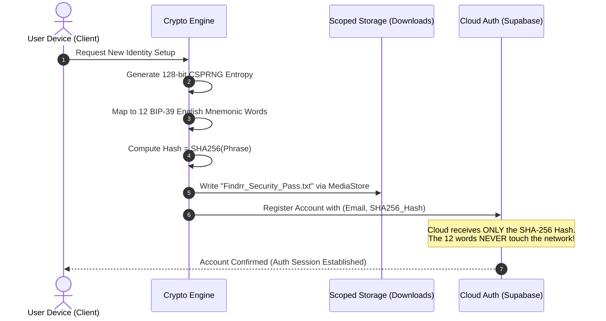

# 02 - Zero-Knowledge Security & Cryptographic Model

## 1. The Zero-Knowledge Paradigm

In traditional fintech applications, the provider acts as a trusted custodian of user financial data. If the provider's database is breached, subpoenaed, or maliciously accessed by an insider, all user transaction histories, bank balances, and merchant records are exposed in plaintext.

**Findrr eliminates this vulnerability by implementing a True Zero-Knowledge Architecture.**

Under this model:
- The server does not know the user's password or master encryption key.
- The server cannot decrypt the user's financial database under any circumstance.
- The server cannot perform password resets or account recovery on behalf of a user.

```
       USER DEVICE                               CLOUD STORAGE
  ┌──────────────────┐                     ┌───────────────────────┐
  │ Plaintext Budget │                     │                       │
  │   $1,250 on Rent │                     │                       │
  └────────┬─────────┘                     │                       │
           │                               │                       │
     AES-256-GCM                           │                       │
  Client Encryption                        │                       │
           │                               │                       │
           ▼                               │                       │
  ┌──────────────────┐   Encrypted Sync    │  ┌─────────────────┐  │
  │ Ciphertext Blob  ├────────────────────►│  │ Ciphertext Blob │  │
  │ 8f9b4c02e1...    │    (Over HTTPS)     │  │ 8f9b4c02e1...   │  │
  └──────────────────┘                     │  └─────────────────┘  │
                                           │  Cannot be decrypted  │
                                           │    by cloud admins    │
                                           └───────────────────────┘
```

---

## 2. Cryptographic Specifications

### 2.1. Symmetric Cipher: AES-256-GCM
When the user opts in to cloud backup, their local SQLite entities are serialized into an optimized JSON schema and encrypted using **AES-256-GCM (Galois/Counter Mode)**.

- **Key Size:** 256 bits (32 bytes).
- **Mode:** Galois/Counter Mode (GCM).
- **Initialization Vector (IV):** Cryptographically secure, randomly generated 96-bit (12-byte) nonce per encryption cycle via `SecureRandom`. Nonces are prepended to the ciphertext and never reused.
- **Authentication Tag:** 128-bit authentication tag generated during encryption. This guarantees both **confidentiality** and **ciphertext integrity** (preventing bit-flipping and tampering attacks).

### 2.2. Key Derivation Function: PBKDF2WithHmacSHA256
The master encryption key is derived directly from the user's **12-Word Secret Recovery Phrase**:

$$\text{MasterKey} = \text{PBKDF2}(\text{Phrase}, \text{Salt}, \text{Iterations} = 100,000, \text{KeyLength} = 256)$$

- **Salt:** 128-bit unique salt stored locally in Android EncryptedSharedPreferences.
- **Iteration Count:** 100,000 rounds of HMAC-SHA256, protecting against brute-force and GPU/ASIC rainbow table dictionary attacks.

---

## 3. The 12-Word Secret Recovery Pass & Storage Architecture

### 3.1. Passphrase Generation Lifecycle
During onboarding, the application client generates an offline 12-word recovery mnemonic:



### 3.2. Physical Offline Backup (.txt Pass)
Android 10+ enforces strict **Scoped Storage** to protect user files. Findrr leverages Android's `MediaStore.Downloads` API to save an immutable physical pass to the user's local Downloads folder:

- **File Name:** `Findrr_Security_Pass.txt`
- **Contents:** The 12-word mnemonic phrase, timestamp of generation, and clear educational guidelines instructing the user to store the file offline (e.g., USB drive, printed paper, hardware vault).
- **App Permissions:** Requires zero broad storage permissions (`MANAGE_EXTERNAL_STORAGE` is strictly avoided), adhering to Google Play's least-privilege security policy.

---

## 4. Zero-Knowledge Authentication & Password Recovery

Most platforms offer a "Forgot Password?" email link that allows server admins to rewrite account credentials. **Findrr explicitly prohibits server-side password resets.**

### 4.1. The Zero-Knowledge RPC Protocol
If a user forgets their account password, recovery requires proving possession of the original 12-word mnemonic phrase:

1. User enters their 12-word phrase into the Findrr client.
2. The client calculates $H = \text{SHA-256}(\text{Phrase})$.
3. The client calls a protected cloud Remote Procedure Call (RPC):
   ```sql
   -- Conceptual Public Security Specification for RPC Function
   CREATE OR REPLACE FUNCTION reset_password_with_recovery_hash(
       user_email TEXT,
       provided_hash TEXT,
       new_encrypted_secret TEXT
   ) RETURNS BOOLEAN AS $$
   BEGIN
       -- Compares client-submitted SHA-256 with stored hash in constant time
       IF EXISTS (
           SELECT 1 FROM profiles 
           WHERE email = user_email 
             AND recovery_hash = provided_hash
       ) THEN
           -- Update credentials
           RETURN TRUE;
       ELSE
           RETURN FALSE;
       END IF;
   END;
   $$ LANGUAGE plpgsql SECURITY DEFINER;
   ```
4. If $H$ matches the stored hash, the password is reset. If the user loses their 12-word phrase, the data cannot be decrypted by anyone, including Findrr developers.

---

## 5. Threat Model & Security Boundary Analysis

| Attack Vector | Threat Actor | Mitigation Mechanism | Security Result |
| :--- | :--- | :--- | :--- |
| **Cloud Database Leak** | Remote Malicious Hacker | All stored user records are AES-256-GCM ciphertext. Passwords are protected by SHA-256 hashes. | **Zero Data Compromised.** Attacker obtains unusable encrypted blobs. |
| **Malicious Server Admin** | Rogue Employee / Cloud Host | Admins have zero visibility into client master keys or plaintext transaction records. | **Zero Privilege Escalation.** Admins cannot read spending history. |
| **Man-in-the-Middle (MitM)** | Compromised Wi-Fi Router | Transport Layer Security (TLS 1.3) + payload is already pre-encrypted with AES-256 before transmission. | **Double-Layer Protection.** Intercepted traffic is indecipherable ciphertext. |
| **Physical Phone Theft** | Local Device Thief | Android Application Sandbox isolates SQLite database. Database files are inaccessible to non-root apps. | **Protected.** Access requires unlocking the operating system. |
| **Dictionary Attack on Pass** | Automated Botnet | 12-word BIP-39 phrase represents $2^{128}$ possible combinations, making brute-force mathematically impossible. | **Impracticable.** Exhausting the keyspace would require billions of years. |

---

## 6. Privacy Compliance & Zero-Telemetry Guarantee

Findrr enforces a strict **Zero-Telemetry Policy**:
- **No Third-Party Analytics:** The application contains zero Firebase Analytics, Mixpanel, Segment, or Facebook SDK binaries.
- **No Crash Profiling with Sensitive Payloads:** Crash reporting frameworks that capture memory dumps or database snapshots are excluded from production builds.
- **No Ad Trackers:** The monetization engine does not use Google AdMob or programmatic tracking cookies.
