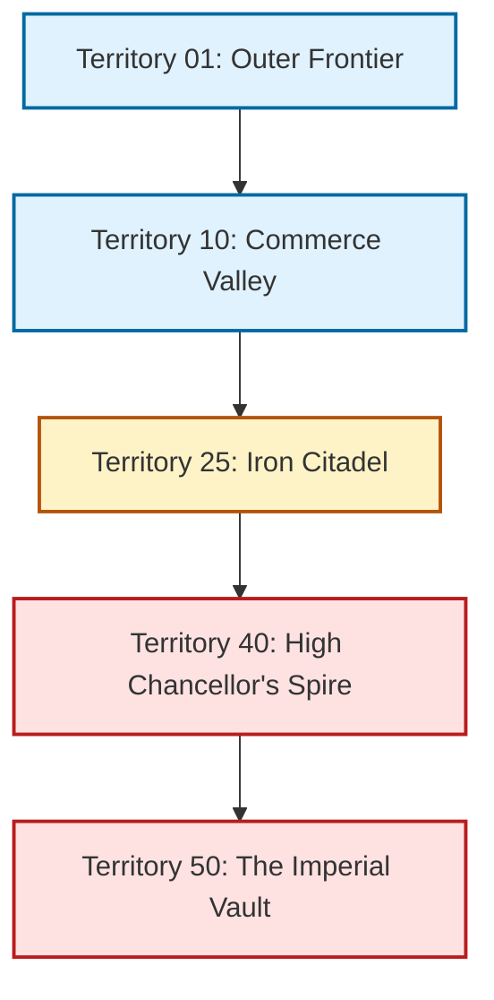
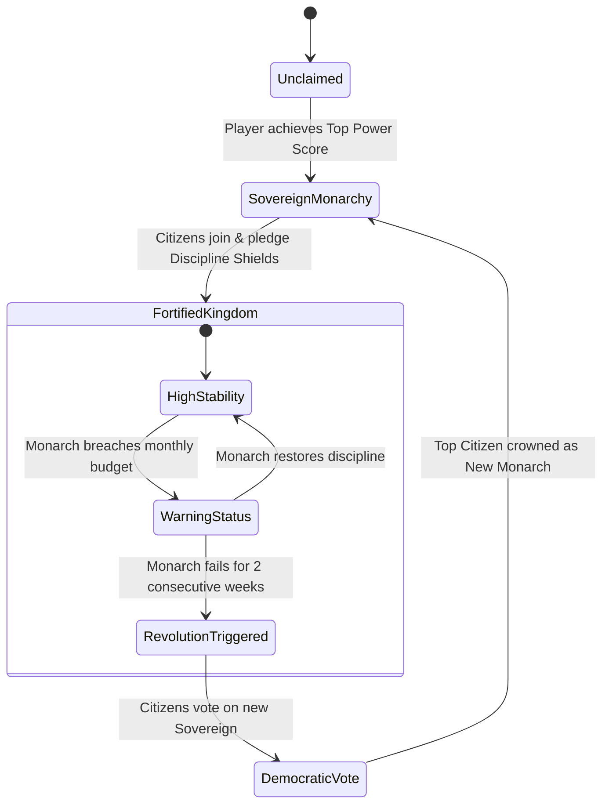

# 04 - Arena: Multiplayer Budget Kingdoms & Game Theory

## 1. The Behavioral Problem with Personal Finance

Traditional personal finance tools suffer from a 90-day user attrition rate exceeding **75%**. The core root causes are psychological:
- **Solitary Burden:** Budgeting is solitary, analytical, and devoid of positive reinforcement.
- **Negative Feedback Loops:** Users typically open finance apps only after overspending, creating guilt and avoidance behaviors.
- **Toxic Comparison:** Direct net-worth leaderboards discourage ordinary earners, as users with higher incomes automatically dominate regardless of financial discipline.

**Findrr Arena** transforms money management into a collaborative, massively multiplayer strategy RPG where **Discipline** is the sole determinant of power.

```
┌────────────────────────────────────────────────────────────────────────┐
│                        THE ARENA MULTIPLAYER LOOP                      │
├────────────────────────────────────────────────────────────────────────┤
│                                                                        │
│   [Daily Financial Discipline]                                         │
│             │                                                          │
│             ▼                                                          │
│   [Income-Equalized Discipline Score Computed]                         │
│             │                                                          │
│             ▼                                                          │
│   [Conquer Territories on the 50-Region Golden Spiral Map]             │
│             │                                                          │
│             ▼                                                          │
│   [Claim Crown as Reigning Monarch OR Rally Citizens in a Fortress]    │
│             │                                                          │
│             ▼                                                          │
│   [Defend Against Hostile Sieges OR Stage Democratic Revolutions]      │
│                                                                        │
└────────────────────────────────────────────────────────────────────────┘
```

---

## 2. The Income-Equalization Mathematics

A fundamental innovation of Findrr Arena is the **Normalized Discipline Score ($S_D$)**. The algorithm guarantees that a university student managing a ₹5,000 monthly allowance and a senior executive managing a ₹300,000 monthly budget compete on a mathematically fair playing field.

### 2.1. The Discipline Score Formula

$$S_D = \left( R_{\text{savings}} \times W_s \right) + \left( C_{\text{streak}} \times W_c \right) + \left( P_{\text{budget}} \times W_p \right)$$

Where:
- **$R_{\text{savings}}$ (Budget Efficiency Ratio):**
  $$R_{\text{savings}} = \min\left(1.0, \, \frac{\text{Budget Allocated} - \text{Actual Expenses}}{\text{Budget Allocated}}\right) \times 100$$
  *Weight ($W_s$):* **0.50** (50% of total score).
- **$C_{\text{streak}}$ (Logging Consistency Index):**
  Logarithmic scale measuring consecutive days of active transaction logging without missing entries:
  $$C_{\text{streak}} = \min\left(100, \, 20 \times \ln(\text{Streak Days} + 1)\right)$$
  *Weight ($W_c$):* **0.30** (30% of total score).
- **$P_{\text{budget}}$ (Category Precision Metric):**
  Measures adherence across distinct category limits rather than just global spending:
  $$P_{\text{budget}} = \left(1.0 - \frac{\sum |\text{Allocated}_i - \text{Actual}_i|}{\sum \text{Allocated}_i}\right) \times 100$$
  *Weight ($W_p$):* **0.20** (20% of total score).

### 2.2. Equalization Case Study

| Metric | Player A (College Student) | Player B (Senior Tech Lead) |
| :--- | :--- | :--- |
| **Monthly Income** | ₹6,000 | ₹250,000 |
| **Monthly Budget** | ₹5,000 | ₹180,000 |
| **Actual Expenditure** | ₹3,800 | ₹145,000 |
| **Budget Savings Ratio ($R_s$)** | $24.0\%$ | $19.4\%$ |
| **Active Daily Streak** | 42 Days | 14 Days |
| **Streak Score ($C_c$)** | 75.2 Points | 54.1 Points |
| **Category Precision ($P_b$)** | 88.0% | 82.0% |
| **Final Normalized Score ($S_D$)** | **78.2 Points** | **68.7 Points** |
| **Match Outcome** | **VICTORY (Conquers Land)** | **DEFEAT (Challenger)** |

*Conclusion:* Player A wins despite having a fraction of Player B's income, because Player A exhibited superior relative financial control.

---

## 3. The 50-Territory Golden Spiral World Map

The Arena world is rendered as a stylized **Golden Spiral (Fibonacci sequence)** map featuring 50 distinct territories ranging from outer perimeter frontiers to the inner royal core.



- **Perimeter Territories (1–15):** Entry-level regions for new budgeters. Lower shield health requirements.
- **Mid-Tier Strongholds (16–35):** Requires sustained multi-week consistency streaks to breach defenses.
- **Core Sovereign Citadels (36–50):** Highly competitive zones where only the top 1% disciplined savers maintain monarchies.

---

## 4. Territorial Monarchy, Fortresses & Democratic Revolutions

Territories in Findrr operate under dynamic political state machines governed by smart algorithmic rules:



### 4.1. The Reigning Monarch
- The user who records the highest Power Score in a territory claims the title of **Monarch**.
- **Royal Treasury Dividends:** Monarchs accumulate virtual Arena Gold collected from territory trade activity, which can be redeemed for exclusive cosmetic themes and custom avatar insignias.

### 4.2. Citizens & Fortress Shields
- Other players may pledge allegiance to a territory as **Citizens**.
- The collective Discipline Scores of all citizens combine into a **Fortress Shield**.
- The Fortress Shield protects the territory against siege attacks from rival guilds.

### 4.3. The Democratic Revolution Protocol
If a Monarch exhibits poor financial habits (e.g., repeatedly exceeding their budget or abandoning daily tracking):
1. The territory stability drops into **Warning Status**.
2. If unresolved within 14 days, the system automatically triggers a **Revolution State**.
3. Citizens participate in a one-tap democratic vote. The citizen with the highest local discipline index is automatically crowned the new Monarch, deposing the slacking ruler.

---

## 5. Privacy Guarantees in Multiplayer Networking

To preserve the zero-knowledge ethos, Arena multiplayer networking adheres to strict anonymization:
- **No Absolute Monetary Exposure:** The multiplayer server never receives salary amounts, account balances, or transaction details.
- **Normalized Vector Transmission:** Only the computed integer score ($S_D \in [0, 100]$), streak count, and chosen alias are synchronized with the game server.
- **Cryptographic User Pseudonyms:** User accounts are identified via one-way salted handles, preventing correlation between a user's real identity and their game profile.
