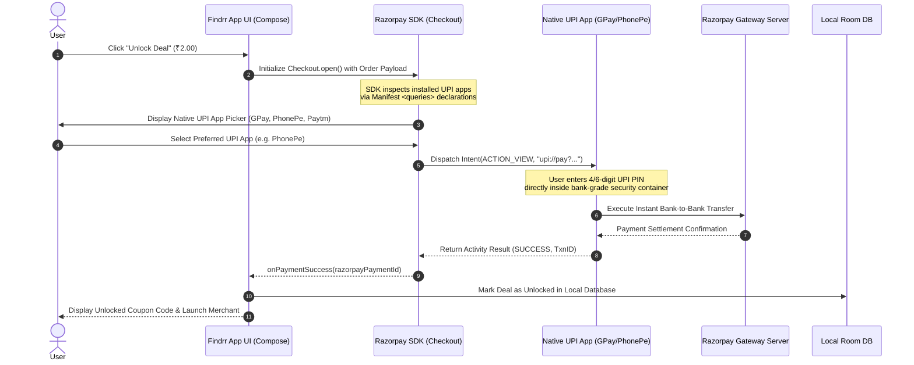

# 05 - Ethical Monetization & Native UPI Payment Infrastructure

## 1. The Ethical Business Model

Traditional consumer apps rely on surveillance capitalism: they harvest user transaction records, profile consumer spending habits, and sell this intelligence to credit rating agencies, insurance firms, and targeted ad networks.

**Findrr explicitly rejects surveillance advertising.** The platform is **100% Ad-Free** and operates on a sustainable, ethical micro-transaction model called the **Discipline-to-Deal Pipeline**.

```
┌────────────────────────────────────────────────────────┐
│              DISCIPLINE-TO-DEAL PIPELINE               │
├────────────────────────────────────────────────────────┤
│                                                        │
│   1. USER BUILDS DISCIPLINE                            │
│      Maintains daily budget and logging streaks.       │
│                                                        │
│   2. EXCLUSIVE PERKS UNLOCKED                          │
│      Qualifies for curated merchant partner coupons    │
│      (Zerodha, Kuvera, Amazon, Swiggy, Healthify).     │
│                                                        │
│   3. ₹2 PLATFORM MICRO-FEE                             │
│      User pays a nominal ₹2 unlock fee via native UPI. │
│                                                        │
│   4. DOUBLE-DIP SUSTAINABILITY                         │
│      Findrr captures ₹2 utility revenue + outbound     │
│      affiliate commissions (via Cuelinks API).         │
│                                                        │
└────────────────────────────────────────────────────────┘
```

---

## 2. Native Razorpay Android SDK & UPI Intent Routing

To deliver a frictionless micro-payment experience on Android, Findrr integrates the **Razorpay Android Standard Checkout SDK** paired with **Native UPI Intent Routing**.

### 2.1. The Android 11+ Package Visibility Challenge
Starting in Android 11 (API Level 30), Google introduced strict **Package Visibility** restrictions. By default, an application cannot query or launch external payment apps (Google Pay, PhonePe, Paytm) unless those package signatures or URL schemes are explicitly declared in the application manifest.

Without explicit declarations, the Razorpay SDK falls back to slow, brittle browser redirects. Findrr resolves this by declaring strict scheme whitelisting in `AndroidManifest.xml`:

```xml
<!-- Public Manifest Architecture Specification: UPI Intent Whitelist -->
<manifest xmlns:android="http://schemas.android.com/apk/res/android">
    <queries>
        <!-- Generic Unified Payments Interface (UPI) Intent Scheme -->
        <intent>
            <action android:name="android.intent.action.VIEW" />
            <data android:scheme="upi" />
        </intent>
        <!-- Paytm Native Deep Link Protocol -->
        <intent>
            <action android:name="android.intent.action.VIEW" />
            <data android:scheme="paytmmp" />
        </intent>
        <!-- Secure HTTPS Web Fallback -->
        <intent>
            <action android:name="android.intent.action.VIEW" />
            <data android:scheme="https" />
        </intent>
    </queries>
</manifest>
```

---

## 3. End-to-End UPI Payment Sequence



---

## 4. Privacy-Preserving Affiliate Pipeline (Cuelinks API)

Once a deal is unlocked, the user is redirected to the partner merchant. Findrr enforces rigorous privacy isolation during affiliate link generation:

- **No User Identity in Redirects:** Outbound affiliate URLs contain zero user email addresses, names, or device identifiers.
- **Pure `Intent.ACTION_VIEW` Handoff:** The application dispatches the target merchant URL directly to the user's default browser or native merchant application using Android's standard intent system:
  ```kotlin
  // Public Architecture Reference: Safe Outbound Intent
  fun launchMerchantDeal(context: Context, affiliateUrl: String) {
      val intent = Intent(Intent.ACTION_VIEW, Uri.parse(affiliateUrl)).apply {
          addCategory(Intent.CATEGORY_BROWSABLE)
          flags = Intent.FLAG_ACTIVITY_NEW_TASK
      }
      context.startActivity(intent)
  }
  ```
- **Zero In-App Webview Tracking:** Findrr does not load merchant checkout pages inside injected WebViews, guaranteeing that third-party cookies cannot inspect the host application memory space.

---

## 5. Security & Configuration Standard

To ensure complete public safety and avoid credential leakage, payment configurations use strictly sanitized environment variables across all deployment pipelines:

```bash
# Public Architecture Reference: Sanitized Environment Variables
RAZORPAY_KEY_ID="rzp_live_placeholder_public_key"
RAZORPAY_MERCHANT_NAME="Findrr Financial Systems"
PAYMENT_CURRENCY="INR"
PLATFORM_UNLOCK_FEE_PAISE="200" # ₹2.00 in smallest currency unit
```

> [!NOTE]
> Under the Razorpay client-side architecture, only the public `KEY_ID` is included in the Android application bundle. The private `KEY_SECRET` is never embedded in the client APK, eliminating reverse-engineering risks.
