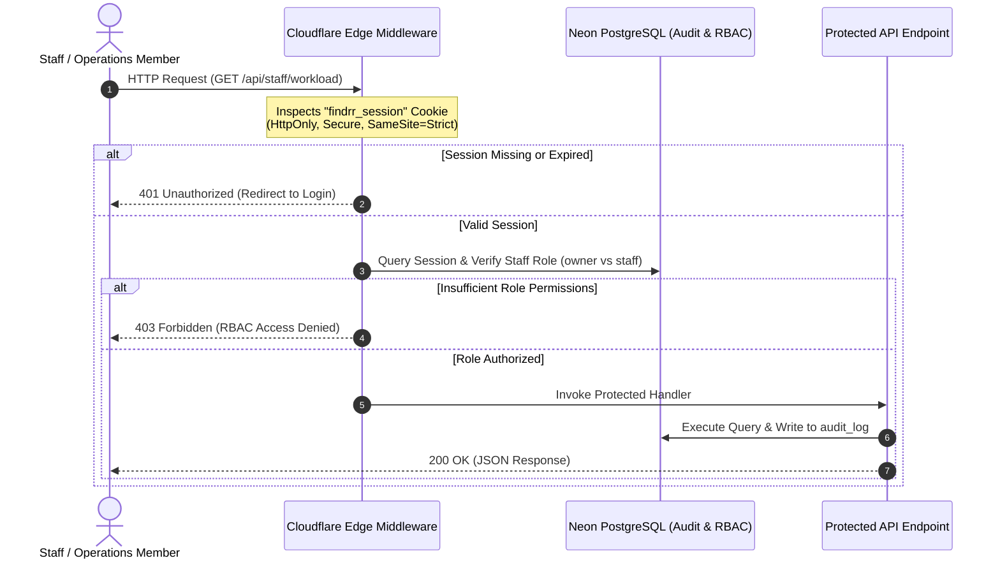

# 06 - Enterprise Operations & Governance Portal

## 1. Architectural Role & Purpose

While the **Findrr Android App** is engineered for decentralized, zero-knowledge personal finance on the user's phone, the **Findrr Operations Portal** functions as the enterprise back-office control plane. It enables operations leads, community coordinators, and customer support engineers to manage public merchant partnerships, organize community financial literacy events, handle member escalation tickets, and coordinate cross-departmental staff workloads.

```
┌────────────────────────────────────────────────────────┐
│               FINDRR OPERATIONS PORTAL                 │
│         Enterprise Web Control Plane (Edge Hosted)     │
├────────────────────────────────────────────────────────┤
│  • Company Team & Workload Distribution               │
│  • Company Notice Board & Announcements                │
│  • 7 Corporate Department Divisions                    │
│  • Tasks & Support Issue Tracking Engine               │
│  • Community Members Directory & Gamification Logs     │
│  • Financial Literacy Events & Workshop Sessions       │
│  • Operations Analytics & SLA Velocity Gauges          │
└────────────────────────────────────────────────────────┘
```

---

## 2. Infrastructure & Edge Compute Stack

The Operations Portal is engineered for zero maintenance overhead, instant global availability, and high operational velocity:

| Tier | Component | Technology Selected | Architectural Rationale |
| :--- | :--- | :--- | :--- |
| **Frontend Presentation** | Single-Page Application (SPA) | Vanilla HTML5 / CSS3 / ES Modules | Zero npm runtime dependencies, zero build-step vulnerabilities, zero CDN tracking, sub-20ms first contentful paint (FCP). |
| **Edge Compute** | Serverless API Functions | Cloudflare Pages & Functions | Runs on Cloudflare's global V8 isolate network. Eliminates traditional Node.js/Docker server maintenance with zero cold starts. |
| **Relational Database** | Serverless SQL Engine | Neon PostgreSQL 16 | Fully managed, serverless PostgreSQL with automated connection pooling and sub-millisecond query performance. |
| **Authentication** | Cryptographic Sessions | HttpOnly Secure Cookies | Stateless session verification with `SameSite=Strict` and SHA-256 password hashing. Zero token storage in local storage. |

---

## 3. Security, RBAC & Central Default-Deny Middleware

All administrative endpoints in the Operations Portal are protected by a centralized **Default-Deny Middleware Architecture**. Unauthenticated or unauthorized requests are rejected at the edge before executing database queries.



### 3.1. Role-Based Access Control (RBAC) Matrix
The portal enforces two strictly defined operational roles:

| Operational Capability | Staff Member (`staff`) | Operations Owner (`owner`) |
| :--- | :---: | :---: |
| **View Workload & Team Directory** | ✅ | ✅ |
| **Manage Assigned Tasks & Issues** | ✅ | ✅ |
| **View Community Members & Events** | ✅ | ✅ |
| **Onboard New Colleague Profiles** | ❌ (Forbidden) | ✅ (Owner Only) |
| **Publish Company-Wide Notices** | ✅ (If Authorized) | ✅ (Owner Only) |
| **Delete / Prune System Audit Logs** | ❌ (Forbidden) | ✅ (Owner Only) |
| **Purge or Modify Core Database Tables** | ❌ (Forbidden) | ✅ (Owner Only) |

---

## 4. Workload Distribution & Department Division Model

To coordinate company operations, the portal organizes personnel across **7 Standard Corporate Divisions**:

1. **🏛️ Executive Leadership:** Strategic planning, governance, and capital allocation.
2. **💻 Engineering & Platform:** Core Android client, cryptographic modules, and edge backend development.
3. **🎨 Product & Design:** User experience, Material 3 design systems, and gamification mechanics.
4. **🤝 Community & Partnerships:** Merchant partner relationships, affiliate pipeline curation, and user advocacy.
5. **🎓 Events & Education:** Financial literacy workshops, webinars, and masterclasses.
6. **🎧 Customer Support:** Ticket resolution, member escalations, and onboarding assistance.
7. **⚙️ Operations:** Infrastructure monitoring, security compliance, and vendor management.

### Real-Time Assignment Tracking
The Workload Management view tracks active employee utilization using dynamic client filters:
- **Active Jobs Only:** Filters out idle staff, showing only personnel currently executing open tasks or resolving support issues.
- **Dynamic Load Distribution:** Visual progress bars track in-progress vs completed deliverables per colleague.
- **One-Click Filtering:** Clicking any employee card instantly navigates to their specific task queue.

---

## 5. Immutable Operational Audit Logging

Every administrative mutation is recorded in an immutable PostgreSQL `audit_log` table:

```sql
-- Public Architecture Specification: Audit Trail Schema
CREATE TABLE IF NOT EXISTS audit_log (
    id UUID PRIMARY KEY DEFAULT gen_random_uuid(),
    staff_id UUID REFERENCES staff(id) ON DELETE SET NULL,
    action VARCHAR(64) NOT NULL,
    entity VARCHAR(64) NOT NULL,
    entity_id VARCHAR(64),
    details JSONB,
    created_at TIMESTAMP WITH TIME ZONE DEFAULT NOW()
);
```

- **Accountability:** Captures exact staff identity, target entity, and timestamp for all actions (e.g. `task_created`, `member_banned`, `notice_posted`).
- **Tamper Evidence:** Logs are append-only. Only the verified `owner` can perform maintenance or pruning operations.
