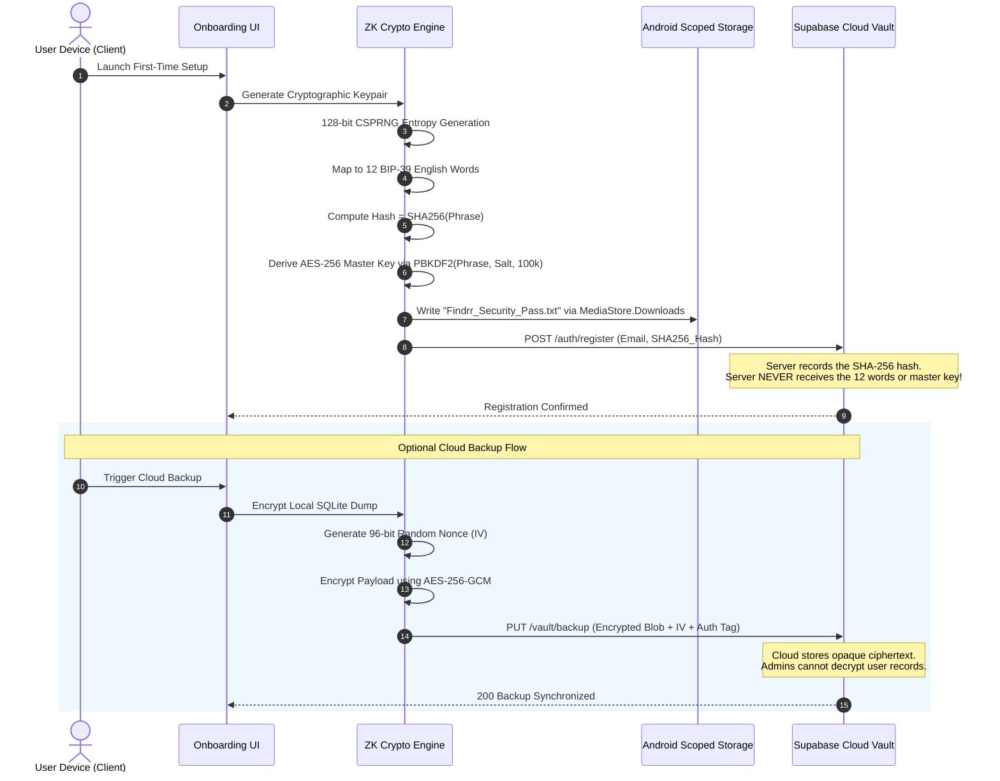
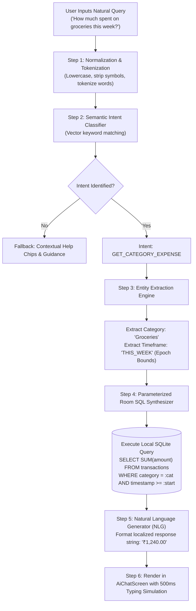
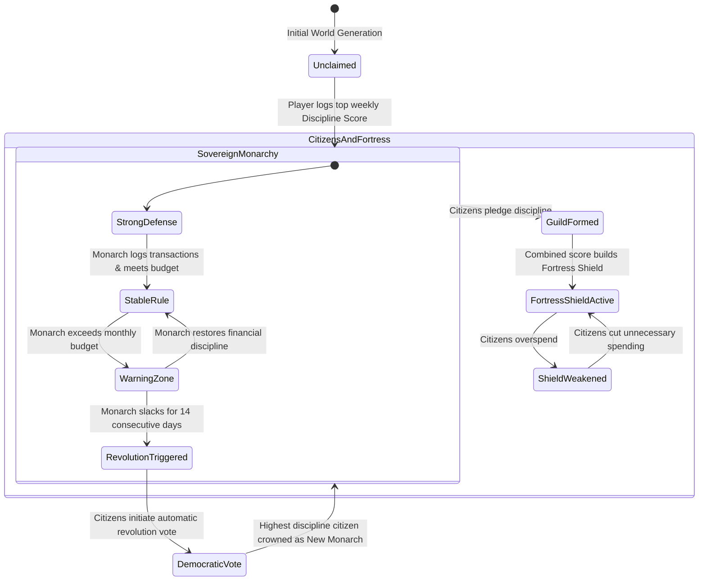
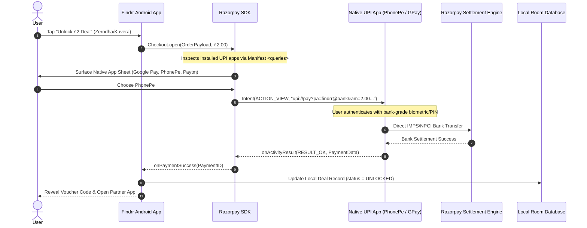
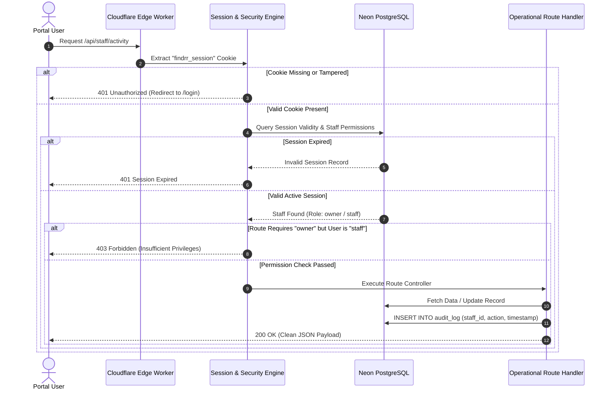

# Findrr Architecture Diagrams Catalog

This document provides a visual catalog of the core architectural patterns, state machines, and sequence workflows operating across the Findrr ecosystem.

---

## 1. End-to-End System Topology

```mermaid
flowchart TB
    subgraph MobileDevice ["Android Client Architecture"]
        subgraph UI_Layer ["Presentation Layer"]
            ComposeUI["Jetpack Compose UI (Material 3)"]
            ChatScreen["AiChatScreen (Lyra UI)"]
            ArenaScreen["ArenaMapScreen (World Map)"]
            HubScreen["SavingsHubScreen (Razorpay UI)"]
        end

        subgraph ViewModel_Layer ["State & Concurrency Layer"]
            VM["FinanceViewModel"]
            StateFlow["StateFlow & SharedFlow (Immutable)"]
            Coroutines["Kotlin Coroutines (Dispatchers.IO)"]
        end

        subgraph Core_Engines ["Domain Core Logic"]
            LyraNLP["Lyra NLU Intent Engine (<1MB)"]
            ScoreEngine["Discipline Score Normalizer"]
            ZKCrypto["AES-256-GCM Envelope Encryption"]
        end

        subgraph Storage_Layer ["On-Device Persistence"]
            RoomDB[("Android Room (SQLite Database)")]
            ScopedPass["Downloads/Findrr_Security_Pass.txt"]
        end

        subgraph Local_IPC ["Edge IPC Interfaces"]
            MCPServer["Localhost MCP Server (Port 8080)"]
            UPIHandler["Native UPI Scheme Interceptor"]
        end
    end

    subgraph Cloud_Infrastructure ["Zero-Knowledge Cloud Relays"]
        SupabaseAuth["Supabase Auth (One-Way Hashes)"]
        SupabaseVault[("Encrypted Backup Vault (Ciphertext)")]
        RazorpayEngine["Razorpay Payment Gateway"]
        MerchantAffiliates["Cuelinks Deals Engine"]
    end

    subgraph Ops_Control ["Operations Portal (Web)"]
        OpsPortal["Findrr Operations Portal (Vanilla SPA)"]
        EdgeWorkers["Cloudflare Pages & Functions"]
        PostgresOps[("Neon Serverless PostgreSQL (RBAC & Audit)")]
    end

    %% Client Internal Connections
    ComposeUI <--> VM
    ChatScreen <--> VM
    ArenaScreen <--> VM
    HubScreen <--> VM
    VM <--> StateFlow
    VM <--> Coroutines

    VM <--> LyraNLP
    VM <--> ScoreEngine
    VM <--> ZKCrypto

    LyraNLP -->|Parameterized Queries| RoomDB
    ScoreEngine <--> RoomDB
    ZKCrypto -->|Generates Offline Pass| ScopedPass
    VM <--> RoomDB

    MCPServer <-->|Local Bearer Token| RoomDB
    HubScreen --> UPIHandler

    %% Cloud Network Connections
    ZKCrypto -.->|Encrypted Sync (AES-256)| SupabaseVault
    VM -.->|Auth Verification (SHA-256)| SupabaseAuth
    UPIHandler -.->|UPI Intent Handshake| RazorpayEngine
    VM -.->|Fetch Deal Catalog| MerchantAffiliates

    %% Operations Portal Connections
    OpsPortal <--> EdgeWorkers
    EdgeWorkers <--> PostgresOps
```

---

## 2. Zero-Knowledge Cryptographic Registration & Sync Flow



---

## 3. Lyra Micro-AI Query Execution Lifecycle



---

## 4. Arena Territory State Machine



---

## 5. Native UPI Payment Lifecycle



---

## 6. Operations Portal Default-Deny Middleware Pipeline


